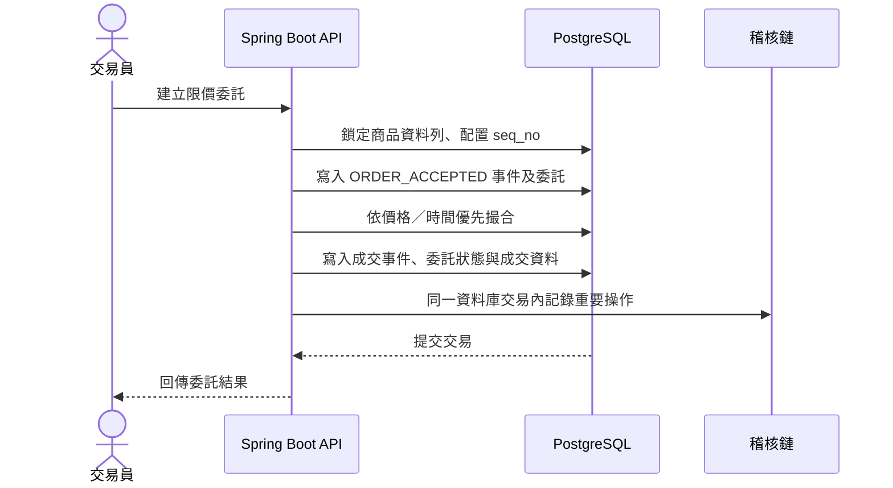

# TradeGuard 與 NonStop Tandem 相關設計說明

← [回 README](../README.md)

## 文件目的

本文整理 TradeGuard 中可與 HPE NonStop（Tandem）交易系統概念相互對照的實作，協助理解交易一致性、事件重播、稽核與故障處理等設計。

**重要界線：TradeGuard 並未使用 NonStop 硬體、Guardian OS、Pathway、TMF 或 Enscribe，也不是 NonStop 系統的移植版或等價替代品。**兩者只在部分交易系統設計目標上可作概念比較。TradeGuard 是以 Java 21、Spring Boot、PostgreSQL 和 Redis 建置的教學型單體後端，部署於一般雲端服務。

## NonStop Tandem 的背景

NonStop Tandem 是面向持續營運與交易處理的容錯平台家族。其產品架構以平台層的容錯能力、交易管理及資料服務支援高可用工作負載。不同世代的 NonStop 產品在硬體、作業系統與軟體元件上有所差異；本文只使用一般性概念，不將任何特定版本功能直接套用到 TradeGuard。

TradeGuard 沒有實作 NonStop 的 process pair、平台級故障切換、TMF 交易管理或 Guardian／Pathway 執行環境。以下對照是「設計目的上的相似處及差異」，不是元件對元件的等價宣稱。

## 概念對照

| NonStop／交易系統常見關注點 | TradeGuard 的相關實作 | 相似之處 | 重要差異 |
|---|---|---|---|
| 交易原子性與一致性 | Spring `@Transactional`、PostgreSQL | 一次委託操作中的相關資料以資料庫交易維持一致，失敗時由資料庫交易回滾。 | 使用一般 PostgreSQL 與應用程式交易，不是 NonStop TMF；未提供跨系統分散式交易協調。 |
| 穩定的交易先後順序 | 商品資料列的 pessimistic write lock、資料庫配置的 `seq_no` | 同一商品的委託透過鎖定與遞增序號形成可重現的處理順序。 | 這不是 NonStop 的全域交易序號服務，也不代表多個獨立撮合節點可安全並行。 |
| 持久化交易事件 | `order_events` 表記錄委託接受、成交及取消 | 事件可用來檢查交易狀態如何形成，並與委託資料互相核對。 | 事件表是 PostgreSQL 應用層資料，不是 Enscribe，也未由資料庫權限或不可變儲存保護免於管理者修改。 |
| 啟動恢復與一致性檢查 | `OrderEventReplayer`、`OrderEventReplayStartup` | 啟動時重播事件，檢查委託投影與商品序號是否與持久化資料一致；不一致時啟動失敗。 | 撮合仍以 PostgreSQL 委託表為準；重播產生的未結委託集合目前主要供恢復驗證，並未取代撮合所讀取的資料。這不是平台級自動故障切換。 |
| 帳務與稽核 | SHA-256 稽核鏈、委託／成交／事件對帳、日終報告 | 可發現部分資料差異或稽核鏈內容遭更動的情況，支援事後檢查。 | 雜湊鏈不是不可竄改儲存；有資料庫寫入權限者仍可能重算資料及鏈。對帳也不等同 NonStop 上的帳務或營運控制。 |
| 依賴故障處理 | Redis 狀態不可用時，登入、token 撤銷及限流採 fail-closed；PostgreSQL 是主要持久資料庫。 | 對部分安全關鍵操作避免在依賴故障時繼續放行。 | Redis 重啟可能清除鎖定、限流及 token 撤銷狀態；目前沒有 NonStop 式冗餘服務、應用程式 process pair 或自動故障接手保證。 |
| 批次／日終處理 | `POST /internal/eod`、GitHub Actions 日終排程 | 提供有 token 保護的日終核對及報告產生流程。 | 由一般 Web API 和 GitHub Actions 執行，不是 NonStop 排程或交易監控環境。 |

## 一筆委託在 TradeGuard 的處理方式

實際程式中，委託接受、撮合及稽核寫入均使用 PostgreSQL 交易；有成交時亦會更新成交雙方委託並保存成交和事件。這種設計著重應用層交易一致性及事後可驗證性，但**不代表**具備 NonStop 平台提供的硬體／程序容錯能力。

## 主要程式位置

- [OrderService](../backend-java/src/main/java/com/tradeguard/order/OrderService.java)：委託接受、冪等重送、撮合、取消及交易事件。
- [OrderEvent](../backend-java/src/main/java/com/tradeguard/order/OrderEvent.java)：委託接受、成交、取消事件模型。
- [OrderEventReplayer](../backend-java/src/main/java/com/tradeguard/order/OrderEventReplayer.java)：事件重播、委託投影比對與商品序號檢查。
- [OrderEventReplayStartup](../backend-java/src/main/java/com/tradeguard/order/OrderEventReplayStartup.java)：應用程式啟動時執行重播驗證。
- [InstrumentRepository](../backend-java/src/main/java/com/tradeguard/instrument/InstrumentRepository.java)：使用 pessimistic write lock 取得商品資料列。
- [AuditService](../backend-java/src/main/java/com/tradeguard/audit/AuditService.java)：稽核雜湊鏈寫入與驗證。
- [ReconciliationService](../backend-java/src/main/java/com/tradeguard/audit/ReconciliationService.java)：核對委託、成交、事件及序號。
- [RedisAuthStateStore](../backend-java/src/main/java/com/tradeguard/security/RedisAuthStateStore.java)：登入鎖定、限流與 token 撤銷狀態。
- [部署說明](deployment.md)：目前 Render、Vercel、Neon PostgreSQL 與 Redis 的部署拓樸及限制。

## 已有驗證

- [OrderApiIntegrationTest](../backend-java/src/test/java/com/tradeguard/order/OrderApiIntegrationTest.java)：`supportsPartialFillsCancellationAndIdempotentRetries` 驗證部分成交、取消與相同委託請求重送；`replaysAppendOnlyEventsIntoOpenOrderBookAndChecksDatabaseProjection` 驗證重播投影與資料庫狀態；`replayFailsClosedWhenAnAcceptedOrderEventIsMissing` 驗證必要事件缺失時啟動／重播失敗。
- [AuditEodApiIntegrationTest](../backend-java/src/test/java/com/tradeguard/audit/AuditEodApiIntegrationTest.java)：`verifiesHashChainAndReportsTampering` 驗證稽核鏈篡改可被偵測；`reconcilesThreeLedgersAndProducesProtectedDailyXmlAndEodResult` 驗證對帳與日終流程。

這些測試驗證指定程式情境，不代表硬體故障切換、雙機持續營運、資料中心災難復原、負載下可用性或 NonStop 相容性已通過測試。

## TradeGuard 目前未提供的 NonStop 等級能力

- 沒有 NonStop 硬體／作業系統、process pair、TMF、Guardian、Pathway 或 Enscribe。
- 沒有 active-active／多實例分散式撮合；同一商品序號及撮合依賴資料庫鎖與單一應用程式的處理模型。
- 沒有跨區域自動故障切換、零停機升級、經驗證的災難復原時間／資料復原點目標，或端到端高可用 SLA。
- Redis 的登入鎖定、限流與撤銷資料可能因服務重啟而遺失；事件及稽核表也沒有 DB 層級防 UPDATE／DELETE 保護。
- Compose、本機整合測試和雲端部署的可用性特性不同；教學用交易一致性測試不能作為金融級營運承諾。

若要將此專案朝高可用交易服務方向擴展，需另行設計並驗證資料庫複寫與故障切換、Redis 持久化或替代狀態儲存、撮合服務單一寫入者／領導者選舉、備份還原、故障注入、監控告警及營運復原演練。這些是後續架構工作，不是目前功能。
